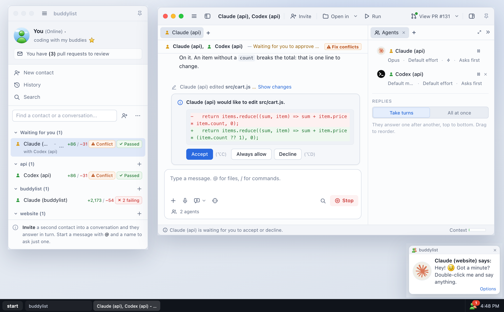

<div align="center">

# buddylist

**Chat with your coding agents like it's 2005.**

Claude Code, Codex, Gemini, OpenCode and Hermes in an MSN Messenger 7.5-style buddy list, on Mac, Windows and Linux.

[](https://github.com/SafaElmali/buddylist/releases/latest)
[](https://github.com/SafaElmali/buddylist/releases/latest/download/buddylist-mac-arm64.dmg)
[](LICENSE)
[](https://buymeacoffee.com/safaelmali)

**[Download for Mac, Windows or Linux](https://buddylist.dev/#download)** · [Live demo](https://buddylist.dev/demo/) · [buddylist.dev](https://buddylist.dev) · [What's new](https://buddylist.dev/changelog)



</div>

It is not a chatbot skin. Each conversation runs a real **Claude Code** session: the same agent loop, tools, settings and login as `claude` in your terminal. Claude reads your project, runs commands and edits files. You just see it as a classic messenger, with a buddy list, conversation windows, nudges and _"Claude is typing a message..."_.

[Codex](docs/codex.md), [Gemini](docs/gemini.md), [OpenCode](docs/opencode.md) and [Hermes](docs/hermes.md) contacts work the same way, on top of the `codex`, `gemini`, `opencode` and `hermes` you already use.

## Highlights

- **A contact for each project.** Double-click one to talk to an agent in that folder. The **+** on a project starts another, in a worktree of its own.
- **Group conversations.** Invite Codex into a chat with Claude and they answer in turn, or `@` the one who should. Or start a contact with a team, such as a reviewer that looks over every change.
- **Permission prompts as invitations.** **Accept (⌥C)**, **Always allow** or **Decline (⌥D)**. A **Nudge** shakes the window and stops the agent.
- **Everything beside the chat.** The files that changed with their diffs, your own terminal, a browser, the subagents Claude hands work to, what it left running in the background, and its check-ins.
- **Pull requests.** **Create PR** asks the contact for one, and the contact list shows the pull requests waiting for your review.
- **Fewer repeated steps.** ⌘K (Ctrl+K on Windows and Linux) finds contacts, conversations by the words in them, files, menu actions and Settings pages, also by the words you'd use for them. Quick send messages the last viewed contact from any app, and saved quick messages keep the requests you use often.
- **Keep work moving.** Invite another provider when a usage limit is reached, or use **Continue with...** to hand unfinished to-dos to another agent. **Contacts > View spending...** totals the costs agents report across your saved history.
- **Two looks.** The classic messenger, or a flat, quiet professional look, by day or at night.
- **Keeps itself up to date.** Mac releases are signed and notarized by Apple. Mac, Windows and AppImage versions download in the background and install on **Restart**.

## Install

- **Mac (Apple Silicon):** [Download the DMG](https://github.com/SafaElmali/buddylist/releases/latest/download/buddylist-mac-arm64.dmg), open it and drag **buddylist** to **Applications**.
- **Windows (x64):** [Download the installer](https://github.com/SafaElmali/buddylist/releases/latest/download/buddylist-win-x64.exe) and run it. Install Git for Windows for Claude Code and project scripts. The Windows installer is unsigned.
- **Linux (x64):** [Download the AppImage](https://github.com/SafaElmali/buddylist/releases/latest/download/buddylist-linux-x86_64.AppImage), make it executable and open it, or [download the Debian package](https://github.com/SafaElmali/buddylist/releases/latest/download/buddylist-linux-amd64.deb) and install it with `sudo apt install ./buddylist-linux-amd64.deb`.

Mac, Windows and AppImage installations download updates in the background. Debian packages show an update notice; install the new `.deb` to update. Intel Mac and ARM Windows/Linux installers are not provided.

The first time, a [welcome wizard](docs/welcome-wizard.md) says which of your agents are ready, signs you in to Claude through your browser if you aren't yet, and ends in your first project. Claude Code is bundled. Codex, Gemini, OpenCode and Hermes contacts use their own CLIs: see [Codex](docs/codex.md), [Gemini](docs/gemini.md), [OpenCode](docs/opencode.md) and [Hermes](docs/hermes.md).

### Run from source

You need macOS, Windows or Linux, [Node.js](https://nodejs.org) 22.13 or newer, and a Claude login. Setting `ANTHROPIC_API_KEY` works too.

```bash
git clone https://github.com/SafaElmali/buddylist.git
cd buddylist
npm ci
npm start
```

You don't need to install Claude Code separately: the Claude Agent SDK includes the binary. To use your own `claude` instead, set `BUDDYLIST_CLAUDE_CLI` to its path.

To work on buddylist, see [Contributing](CONTRIBUTING.md): the tests, the lint and how to send a change.

### Try it without a login

[Open the live demo](https://buddylist.dev/demo/) in your browser, or run the app with scripted contacts:

```bash
npm run demo
```

<details>
<summary>What to type in demo mode</summary>

<br />

What you type picks the reply:

| Your message                | What you get                                                                                                                           |
| --------------------------- | -------------------------------------------------------------------------------------------------------------------------------------- |
| anything                    | a command and an invitation to accept                                                                                                  |
| includes "fix"              | an edit to accept, then a test run                                                                                                     |
| includes "plan"             | a plan to approve                                                                                                                      |
| includes "ask me"           | a multiple-choice question                                                                                                             |
| includes "diagram"          | a reply with a [diagram](docs/conversations.md) drawn in it: click it to see it over the window                                        |
| includes "terminal"         | [terminals beside the conversation](docs/terminal.md): "three terminals", "a terminal for the tests", "two terminals running npm test" |
| includes "subagents"        | two [subagents](docs/subagents.md) at work side by side, each with steps of its own and a report                                       |
| includes "new conversation" | a [conversation of its own](docs/started-conversations.md) for a side task, listed under this one, which hears what came of it         |
| includes "check back"       | a [check-in](docs/check-ins.md): Claude checks back on its own a few seconds later and says how CI is doing                            |
| includes "background"       | a dev server and a watcher on CI [left running in the background](docs/background.md), each with what it prints                        |
| starts with `/`             | the scripted answer to that command                                                                                                    |

To try **Fallbacks**, send exactly `demo weekly limit`, `demo session limit`, or `demo service unavailable` to a solo demo contact (two failed turns for unavailable). Configure the real ordered rules in Settings. A fallback model of `demo-exhausted` simulates spent allowance, `demo-paid-usage` simulates possible charges, and `demo-unknown-usage` returns no usage reading. All are demo-only and never call a paid service.

Codex has no plan to approve, so a Codex contact answers "plan" like any other message. Only a Claude contact can open terminals, start conversations, has subagents to show, sets check-ins or leaves things running in the background, so the others answer "terminal", "new conversation", "subagents", "check back" and "background" that way too. In demo mode a terminal is still your real shell, and a command you accept really runs in it.

</details>

## From terminal to messenger

Everything you do with `claude` in a terminal has a place in buddylist.

<details>
<summary>See where each one went</summary>

<br />

| In the terminal                             | In buddylist                                                                                                                                               |
| ------------------------------------------- | ---------------------------------------------------------------------------------------------------------------------------------------------------------- |
| `cd my-project && claude`                   | Add a **contact** for each project folder, then double-click it. For a question with no project, add one on **This computer**                              |
| Claude's streamed reply                     | "Claude says:" with Markdown, emoticons and Mermaid diagrams, and _"Claude is typing a message..."_ in the status bar                                      |
| Tool calls (`Bash`, `Edit`, `Read`, …)      | Lines like _"Claude ran `npm test`"_, with **Show output** and **Show changes** links. Calls in a row fold into _"Claude ran 3 commands and read 2 files"_ |
| Permission prompt (Yes / Always / No)       | An MSN-style invitation: **Accept (⌥C)**, **Always allow**, **Decline (⌥D)**                                                                               |
| `Esc` to interrupt                          | **Nudge**: shakes the window and stops Claude. Or press `Esc` twice, or click **Stop**                                                                     |
| `↑` for what you typed before               | **↑** in the message box: the messages you sent in the conversation, and **↓** back to what you were writing                                               |
| `Esc` `Esc` to rewind or edit what you sent | **↶** or **✎** under a message you sent: go back to just before it, or send it again changed. Claude forgets it and everything after it                    |
| `Shift+Tab` permission modes                | The mode badge under the conversation, or **Conversation > Permission mode**: Ask first, Auto-accept edits, Plan mode, Never ask                           |
| Plan mode / `AskUserQuestion`               | The plan opens in a pane beside the conversation, and the questions appear in the chat, with buttons to answer                                             |
| `@file` mentions, pasted screenshots        | Type `@` for the folder's files, or use the **+** under the message box (pictures go in as pictures, the rest as `@` mentions), drag and drop, or paste    |
| Prompts you type again and again            | **Quick messages** under the message box: _Run the tests and fix the ones that fail_ and your own, in with a click                                         |
| `/compact`, `/review`, other slash commands | Type `/` for a list, or **Conversation > Commands** for every command your Claude Code has. `/clear` or **Conversation > Start over** starts a new chat    |
| `/model`, `/effort`                         | The **model badge** under the conversation: its model, effort level and fast mode, from the models your CLI has                                            |
| `/output-style`                             | **Conversation > Output style**: Default, Proactive, Concise, Explanatory, Learning and the styles you wrote yourself                                      |
| `/mcp`                                      | **Conversation > MCP servers**, or type `/mcp`: how each server is doing, with Reconnect, Sign in, Enable and Disable                                      |
| `/context`, `/usage`                        | The **meter** in the status bar, or type `/context`: what fills the context window, and your plan's limits and usage credits                               |
| `/login` with another account               | **Settings > Accounts**: add another Claude account. When one reaches its limit, the conversation offers to go on in the next                              |
| `git status`, `git diff HEAD`               | The **Changes** tab beside the conversation: the files that changed, each with its diff. It looks again after a turn                                       |
| Subagents, and the agents panel             | The **Subagents** tab: what each one is doing right now, its steps and its report, with a **Stop** of its own                                              |
| `run_in_background`, `/tasks`               | The **Background** tab: the commands and watchers Claude left running, what each printed, with a **Stop** of its own                                       |
| `/loop`, "check back in 10 minutes"         | **Check-ins**: Claude checks back on its own when it said it would, and the status bar and contact list say when                                           |
| "commit, push and open a PR"                | **Create PR** in the toolbar asks the contact for it, as a draft too. Then the button is **View PR**                                                       |
| `claude --resume`                           | Conversations pick up where they left off when you reopen the app                                                                                          |
| Scrollback you lost to `/clear`             | **View message history** keeps your past conversations with each contact, to read, search and save                                                         |
| The sessions `/resume` lists                | **History** lists them from the first day, by folder, and a contact's **View message history** has its folder's: to read, search and save                  |

</details>

## Guides

**Using it**, also at [buddylist.dev/docs](https://buddylist.dev/docs/)

- [Getting started](docs/getting-started.md): installing the app, the welcome wizard and your first conversation
- [The welcome wizard](docs/welcome-wizard.md): what a new install opens with, and **Help > Getting started**
- [Questions and answers](docs/faq.md): what people ask about buddylist, from GitHub and group chats to shortcuts and privacy
- [Conversations](docs/conversations.md): saving a chat, output styles, your contacts beside the conversation, plans, the Changes tab, Create PR and message history
- [The contact list](docs/contact-list.md): statuses, groups, projects, worktrees, pull requests, archiving, the command palette, quick send, spending and music status
- [Group conversations](docs/group-conversations.md)
- [Subagents](docs/subagents.md): what the subagents a Claude contact hands work to are doing, and stopping one
- [Background](docs/background.md): the commands and watchers a Claude contact left running, what each printed, and stopping one
- [Check-ins](docs/check-ins.md): what a Claude contact set itself to check back on, and when it is due
- [Started conversations](docs/started-conversations.md): a conversation an agent starts for a side task, using its service and settings, and what it hears back
- [Schedules](docs/schedules.md): prompts that start a contact by themselves, on a cadence, and the runs missed while the app was closed
- [Project managers](docs/project-managers.md): a manager on your choice of service that follows PRDs, tickets and designs, and checks the conversations assigned to it, with read-only guests that hand changes to workers
- [Accounts](docs/accounts.md): each Claude account’s allowance, optional switching before a limit, and fallback spending rules
- [Codex](docs/codex.md), [Gemini](docs/gemini.md), [OpenCode](docs/opencode.md) and [Hermes](docs/hermes.md)
- [The Run button](docs/run-button.md): your project's dev server, on a port of its own for each contact
- [The terminal](docs/terminal.md): your own shell in a contact's folder, beside the conversation
- [The browser](docs/browser-tab.md): a web page beside the conversation, for a dev server or a link from a reply
- [PR stacks](docs/pull-request-stacks.md): GitHub's own stacks bottom to top, or confirmed parents and dependents by branch, uncertain relationships and a tab you can pin beside the conversation
- [Settings](docs/settings.md): the app's own, and each project's scripts, variables, branches, instructions, manager and files to copy
- [Remote access](docs/remote-access.md): buddylist on your phone through Tailscale: who waits for you, replies, permissions, questions, plans, Stop and notifications, what each phone may do, and opening with your computer out of reach
- [Voice clips](docs/voice-clips.md)
- [The MSN look](docs/msn-look.md) and [the professional look](docs/professional-look.md)
- [Your own display pictures](docs/display-pictures.md)

**Working on it**

- [How the code is organized](docs/architecture.md)
- [Adding a provider](docs/adding-a-provider.md)
- [Try it in a browser](docs/browser-preview.md)
- [Build the app](docs/building.md)
- [Releases and updates](docs/releases.md): publish a version, include new commits and get updates to existing users
- [Landing page](docs/landing-page.md)
- [Feature videos](docs/feature-videos.md): a narrated video of the real app, with a camera that follows what happens, and a loop for the changelog
- [Feedback, bugs and requests](docs/feedback.md): the form in the app and on the page, and reading what arrives
- [Error reports](docs/error-reports.md): what an installed app reports when something goes wrong, what it leaves out, and turning them off
- [Analytics](docs/analytics.md): what the page and the app count, where it goes, and turning it off
- [Bundled MSN media](docs/bundled-media.md): where the sounds and the default Winks come from, and why the guides don't mention them

## Development

[Remote access](docs/remote-access.md), turned on in Settings, serves a phone app of the running app's contacts and conversations to a phone paired through Tailscale.

```bash
npm test            # unit tests (sessions, conversations, storage, IPC contract, …)
npm run lint        # ESLint + Prettier
npm run format      # fix formatting
npm run demo        # the UI with scripted fake contacts
npm run build:app   # bundle and minify the code into dist/app/, as `npm run dist` packs it
npm run icon        # re-render the app icon's sizes and the touch icon from build/icon-art.png
npm run screenshot  # retake docs/screenshot.png from the browser preview
npm run promo       # film dist/promo/worktree.mp4, the clip of the + on a contact (needs ffmpeg)
npm run og-image    # retake the landing page's link-preview card
```

Where things are stored:

- Your contacts and chat history: `~/Library/Application Support/buddylist/` on Mac, `%APPDATA%\buddylist\` on Windows, or `~/.config/buddylist/` on Linux (`$XDG_CONFIG_HOME/buddylist/` when set). Past conversations are in `history/archive/`, one JSON file each. Who is invited into a conversation is kept with its contact.
- One copy of the app runs on that folder at a time. Starting another, such as `npm start` or `npm run demo` while the installed app is open, brings the open one to the front instead. To run one beside it, give it a folder of its own: `BUDDYLIST_USER_DATA=/tmp/buddylist npm run demo`.
- Claude Code's own session transcripts: `~/.claude/`

## Privacy and safety

- **Error reports.** An installed app reports its own errors and crashes, without your conversations, your name or your home folder. **Tools → Send error reports** in the contact list turns them off. See [Error reports](docs/error-reports.md).
- **Anonymous usage counts.** The installed app counts that it was opened and which features were used, never what was written or the name of anything. A run from the source sends nothing. Turn it off with **Tools → Share anonymous usage data**; [Analytics](docs/analytics.md) lists every count.
- **Never ask mode** lets a contact run anything without asking. So does OpenCode's Build mode, unless your `opencode.json` says otherwise, and Hermes runs any command it doesn't find dangerous. Only use it in folders you don't mind breaking.
- **For your own use.** It is meant for your own Claude login. If you share a build with other people, have them use their own API keys, per Anthropic's [Agent SDK terms](https://code.claude.com/docs/en/agent-sdk).
- **Found a vulnerability?** See the [security policy](SECURITY.md).

## Support

If buddylist is useful to you, you can [buy me a coffee](https://buymeacoffee.com/safaelmali); the app's **Help → Buy me a coffee** opens the same page. [Sponsoring](https://buddylist.dev/sponsor) works too, monthly on GitHub Sponsors or as a company. Bugs and ideas are welcome through **Help → Send feedback...** or the [form on buddylist.dev](https://buddylist.dev/#feedback).

## License and credits

The code is [MIT](LICENSE).

- The Claude spark and the Claude Code mascot are Anthropic's marks. Their SVG paths come from [Simple Icons](https://simpleicons.org).
- The bundled classic Winks and their soundtracks, and the [notification recordings](docs/msn-look.md#the-classic-sounds), are Microsoft's original MSN Messenger media. See the [pack attribution](src/pack/README.md).
- Other interface artwork is original SVG, including the Codex, Gemini, OpenCode and Hermes pictures.
- The app and the live demo each carry `THIRD_PARTY_NOTICES.txt`, with the license of every package and copied file they ship. The build writes it from what it bundles ([`scripts/notices.js`](scripts/notices.js)); the app has it beside its resources, and the demo at `/demo/THIRD_PARTY_NOTICES.txt`.

The artwork and sounds that belong to Anthropic or Microsoft are theirs, and the license does not cover them. buddylist is an independent project, not affiliated with or endorsed by Microsoft, Anthropic, OpenAI or Google.
